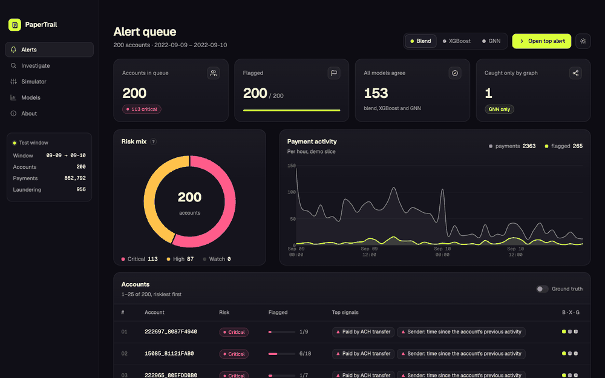
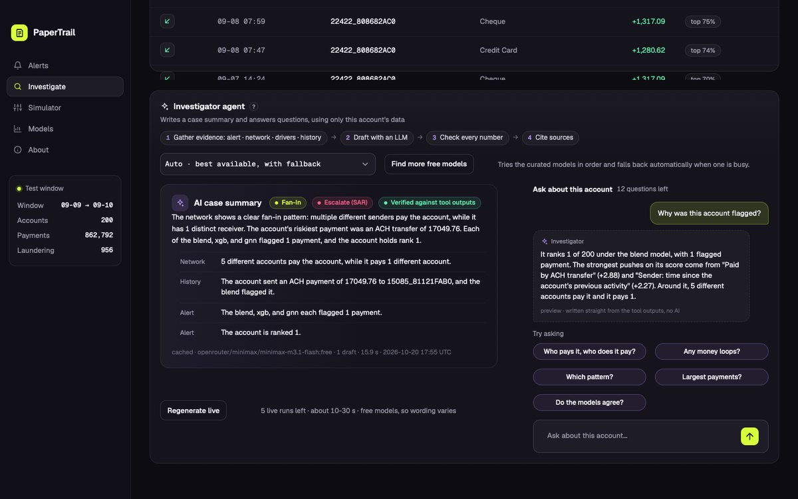
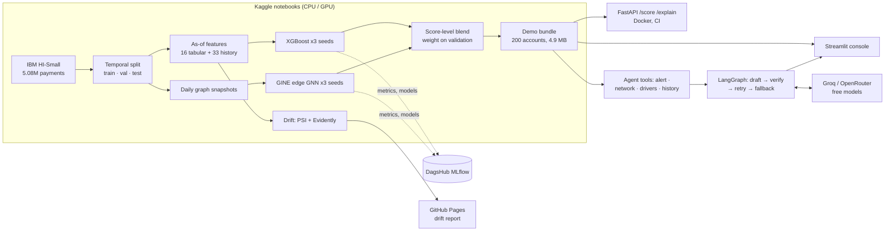

# PaperTrail

**Find money laundering among millions of ordinary payments, and show why.**

PaperTrail ranks bank accounts and payments by how suspicious they look, using gradient-boosted trees on each account's payment history plus a graph neural network on the payment network. It explains every score, and an LLM investigator writes case files and answers questions without being allowed to invent a number.

**[Live demo](https://papertrail-aml.streamlit.app)** · **[Drift report](https://abhibarnwal707.github.io/PaperTrail/)** · **[Experiments on DagsHub](https://dagshub.com/abhibarnwal707/papertrail)**



| | Test result (Sep 9–10, 862,792 unseen payments, 956 laundering) |
|---|---|
| Best model | Blend of GNN + XGBoost: **PR-AUC 0.497**, **72% of laundering found at a 1% false-alarm rate** |
| Gain from the graph | The GNN catches **127 laundering payments XGBoost misses** at that budget; the blend beats both models on all four metrics |
| Investigator agent | 30/30 case summaries pass the number check, **0 of 6 clean accounts escalated**, about 9 s per case on free LLMs |
| Scoring API | **1.6 ms p50 / 2.1 ms p95** per request, 3-model ensemble |

> The data is synthetic (IBM's AML simulator). This is a demonstration of method, not a product for real banks, and the accounts are not real people.

---

## 1. The problem

Banks must report laundering, but it is about **1 payment in 980**. A model that flags nothing is 99.9% "accurate" and useless. In practice almost every alert is a false alarm, and analysts lose hours piecing each case together from scores, counterparties and payment histories. PaperTrail tries to do three things well:

1. **Rank**: put the few real cases at the top of the queue, measured at the alert budgets analysts actually work with.
2. **Explain**: say which facts pushed each score up, and show the network around the account.
3. **Summarise faithfully**: draft the case file with an LLM, but check every number it states against the data it cites.

## 2. Live demo

**[papertrail-aml.streamlit.app](https://papertrail-aml.streamlit.app)** (free hosting; the first visit after a quiet spell takes about 30 s to wake up).

- **Home**: what PaperTrail does and its headline results, a live model switch, and an "open a case" picker that jumps straight into any account. A light/dark switch sits in the sidebar on every page.
- **Alerts**: 200 accounts from the test window, ranked by the selected model (Blend / XGBoost / GNN), with risk tiers, top signals and which models agree. A "ground truth" switch reveals the real answers.
- **Investigate**: the payment network (flagged payments in red), the score drivers, a timeline of payments, and the **investigator agent**: a cached case summary, live regeneration with a model picker, and a chat ("Who pays it?", "Any money loops?") whose answers cite their sources.
- **Simulator**: describe a payment and a sender profile and see whether XGBoost would raise an alert, with the reasons.
- **Models**: the comparison below, precision-recall curves, recall by laundering pattern, why two models beat one, and a link to the drift report.



## 3. Architecture



Code lives in `src/papertrail/` (tested); notebooks only orchestrate. Heavy work runs on Kaggle and is logged to DagsHub; the laptop only edits code.

## 4. Dataset

[IBM Transactions for Anti-Money Laundering](https://www.kaggle.com/datasets/ealtman2019/ibm-transactions-for-anti-money-laundering-aml), **HI-Small**: 5,078,345 payments between 515,088 accounts over 18 days, 5,177 of them laundering (0.102%). It is generated by a multi-agent simulator, so it has artefacts a real bank's data would not, and I treat them openly:

- **One payment format dominates.** ACH carries 86.6% of all laundering; Wire and Reinvestment carry none. The model leans on it (`is_ach` plus its duplicate `fmt_ACH` hold about 30% of XGBoost's gain), so "the data says ACH" is partly "the simulator says ACH".
- **The tail is distorted.** Normal traffic stops after Sep 10 while laundering chains keep finishing until Sep 18 (59% laundering rate). Those 1,108 rows are never scored.
- **Day 1 is a burst.** Sep 1 holds 22% of all rows, including all ~481k Reinvestment payments in the dataset (mostly self-transfers, bunched around midnight), which never launder. It skewed several analyses (see section 10).
- **Only 62% of laundering has a known pattern.** The patterns file maps 3,209 of 5,177 positives to 8 typologies (FAN-IN, FAN-OUT, CYCLE, SCATTER-GATHER, GATHER-SCATTER, STACK, BIPARTITE, RANDOM); the rest are unlabelled, so pattern-level numbers cover only the mapped share.

Account numbers are only unique within a bank, so an account is `{bank}_{account}` everywhere.

## 5. Evaluation protocol

| Split | Dates | Payments | Laundering |
|---|---|---|---|
| Train | Sep 1–6 | 3,248,921 | 2,530 (0.078%) |
| Validation | Sep 7–8 | 965,524 | 1,036 (0.107%) |
| Test | Sep 9–10 | 862,792 | 956 (0.111%) |

- **Split by time, on day boundaries, with no leakage.** Every feature is computed "as of" the payment, from earlier payments only (unit-tested: appending later rows never changes earlier features). GNN message passing uses only edges from earlier days.
- **Thresholds and blend weights are chosen on validation; test is scored once per model.**
- **Never accuracy.** PR-AUC (ranking quality), minority-class F1, **recall at a 1% false-positive rate** (laundering found when analysts accept reviewing 1 in 100 normal payments) and precision in the top 1,000.
- **Three seeds per model, reported as mean ± std.** An early "best" result turned out to be one lucky seed (section 10), so single runs are never quoted.
- Limits: 956 test positives, so differences of a few hundredths are noise; laundering attempts (median 75 hours) can straddle split boundaries.

## 6. Model comparison (test, 3-seed means)

| Model | PR-AUC | F1 | Recall @ 1% FPR | Precision @ 1000 |
|---|---|---|---|---|
| Rules (ACH, amount band, send bursts) | 0.008 | 0.030 | 0.012 | 0.000 |
| XGBoost, payment details only | 0.065 ± 0.003 | 0.148 | 0.454 | 0.145 |
| XGBoost + account history (49 features) | 0.436 ± 0.004 | 0.506 | 0.659 | 0.443 |
| GNN (GINE, payment network only) | 0.255 ± 0.025 | 0.297 | 0.675 | 0.290 |
| **Blend of GNN + XGBoost** | **0.497 ± 0.016** | **0.542** | **0.724** | **0.475** |

- **Account history is the big step** (0.065 → 0.436 PR-AUC). An ablation shows that the all-time totals and "time since last activity" family carries most of it.
- **The GNN, with no history features at all, is 4× the payment-only model**, and it finds laundering XGBoost misses: at a 1% false-alarm budget, 550 laundering payments are caught by both models, **127 by the GNN only**, 78 by XGBoost only, and 201 by neither.
- **The blend wins on all four metrics.** Logits are standardised on validation and mixed with a GNN weight of 0.4, which was stable between 0.3 and 0.4 across seeds.
- **Recall by pattern** at each model's alert line: the blend ranges from 0.52 (STACK) to 0.78 (GATHER-SCATTER). Unlabelled laundering is almost never caught at that strict line, but at the 1% budget the blend finds at least about 110 of those 371.

Full tables: [`reports/final_comparison.csv`](reports/final_comparison.csv), findings and ablations: [`reports/eda_summary.md`](reports/eda_summary.md).

## 7. Investigator agent

A [LangGraph](https://github.com/langchain-ai/langgraph) flow in `src/papertrail/agent/`:

1. **Gather**: four tools read the demo bundle (alert ranks, network summary, score drivers, recent payments), each output tagged with a `source_id`. The ground-truth columns never reach the model.
2. **Draft**: an LLM writes a `CaseSummary` (pydantic): the suspected pattern, 3–6 evidence claims each citing one source, a short narrative and an action (`escalate_SAR` / `enhanced_review` / `close_false_positive`).
3. **Verify**: every cited source must exist, and **every number in a claim must be a rounding of a number in the source it cites**. Sums and percentages the model computed are rejected.
4. **Retry once** with the checker's error list; if it still fails, **fall back** to "pattern unclear" with only the verified claims. That is at most 6 tool + LLM calls per case.

Models are free-tier: a curated, tested list (Groq `gpt-oss-120b`, `qwen3.8-27b`, `gpt-oss-20b`; OpenRouter `minimax-m3.1-flash` as backup) with automatic fallback on rate limits, and a "find more free models" option in the app. The same checker guards the chat.

**Evaluation on 30 accounts** (3 per laundering pattern + 6 clean accounts the models flagged; [`reports/agent_eval.md`](reports/agent_eval.md)):

| Metric | Result |
|---|---|
| Summaries that pass the number check | 30 / 30 |
| First-draft claims with numbers faithful to the cited source | 99% of 154 |
| Fabrications caught and fixed on the retry | 2 (a number from the wrong source; "top 50" lifted from the prompt's own rule) |
| Meaning errors about which payment is "most recent" | 0 (4 in the first run, fixed, see section 10) |
| Clean accounts escalated to a suspicious-activity report | **0 of 6** |
| Laundering accounts escalated | 14 of 24 |
| Pattern named correctly (laundering accounts) | **25%** (6 answered "unclear") |
| Latency per case, mean / p95 · tokens | 9.2 s / 13.8 s · about 4,800 |

**The pattern accuracy is low, and I report it as such.** The agent sees one account's capped two-hop neighbourhood, most of these accounts belong to several patterns at once, and recognising a pattern from one participant's position is genuinely hard. The value is a fast, sourced, number-checked first draft; the pattern label is a hint.

## 8. Serving and monitoring

- **Scoring API** (`api/`, FastAPI + Docker): `POST /score` (3-booster ensemble) and `GET /explain/{account}`. Latency with the real model, in-process: **p50 1.6 ms, p95 2.1 ms, p99 2.4 ms** ([`reports/latency.md`](reports/latency.md)). CI runs ruff, pytest and the Docker build on every push.
- **Drift** ([report](https://abhibarnwal707.github.io/PaperTrail/), `src/papertrail/drift.py`): PSI against the training window (Sep 2–6). Payment details and 24-hour behaviour are stable on the test window (25 of 26 features below 0.1), and the models' scores barely move (PSI 0.05–0.07). Features built on 7-day windows or all-time totals drift strongly, but only because the data starts on Sep 1 and those windows fill up during the period (they jump on Sep 8–9, exactly when 7-day windows first fill), so they are reported and excluded from the trigger. **Retraining trigger: PSI > 0.2 on 3 or more of the 15 most important calendar-stable features**, checked daily; on the test window it fires on none. With 10 days of synthetic data this shows that the mechanism works, not how real drift would look.

## 9. Design decisions and trade-offs

- **Score-level blend instead of one joint model.** Each model stays simple and separately evaluated, the weight is one number chosen on validation, and the app can show each model's own evidence (feature drivers for XGBoost, the network for the GNN).
- **GNN in plain PyTorch.** A GINE edge classifier on daily graph snapshots with a numpy neighbour sampler; PyG's samplers needed compiled extras that did not install cleanly. Each payment is scored only from earlier days' graph.
- **No PyTorch in the demo.** GNN and blend scores are precomputed into a 4.9 MB bundle, so the app runs on free hosting in well under 1 GB; only XGBoost runs live (Simulator, API).
- **Account history over hand-written rules.** Rules topped out at PR-AUC 0.008; the "as-of" history features are what made the model work.
- **Agent rules enforced in code, not in the prompt alone.** The prompt asks for faithful numbers; the verifier makes them mandatory. Ground truth is physically kept out of the tools, so the evaluation is fair.
- **Drift trigger that ignores calendar effects**, because a naive PSI alarm would demand retraining every day on this data.
- **The console keeps state in the URL** (page, model, account, theme), so any view can be linked; light and dark themes; plain-language labels instead of feature names.

## 10. What failed, and what I changed

- **The first headline number was a lucky seed.** XGBoost v2 scored 0.351 PR-AUC; three seeds gave 0.312 ± 0.034. Since then every number is a 3-seed mean, and steadier training settings (shallower trees, stronger regularisation, square-root class weight) raised the model to 0.442 ± 0.004 (0.436 after dropping account age, below).
- **A burst-detection rule did not help** (rules v2: 0.007 vs 0.008 PR-AUC). Raw send volume is a weak signal on its own.
- **"Account age" was a calendar artefact.** It measured time since the account first appeared in this 18-day window, so it grew with the calendar. Dropping it cost about 0.006 PR-AUC; it is gone.
- **"Calendar-stable" features were worse, not better** (0.37–0.39 vs 0.44). The 7-day and all-time features carry signal beyond 24-hour windows; whether that is behaviour or partly an observation-window effect cannot be separated with 10 days of data.
- **I expected the GNN to excel at money cycles. It does not** (CYCLE recall: GNN 0.33, XGBoost 0.53, blend 0.58). It helps through complementarity, not one pattern.
- **The first drift run demanded retraining, wrongly.** Two bugs: the saved models carry no feature names, so every importance mapped to zero; and the Sep 1 burst made the training reference unrepresentative (Reinvestment 15% of train, 0% of test). Fixed by mapping names by position and using Sep 2–6 as the reference (all Reinvestment payments fall on Sep 1).
- **The agent's first run was numerically faithful but wrong in meaning 4 times.** My prompt told it to write "the most recent payment" instead of dates, and it used that phrase for the riskiest payment. The number check cannot see that. I fixed the prompt, made the drivers tool state which payment it explains, and added an automatic meaning check: 0 errors on the rerun. The same rerun tightened the SAR rule (1 of 6 clean accounts escalated → 0).
- **Free reasoning models returned empty answers.** They spent their whole token budget thinking. Fixed by requesting low reasoning effort; models that still run out are skipped.

## 11. How to run

```bash
git clone https://github.com/abhibarnwal707/PaperTrail.git && cd PaperTrail
pip install -e ".[dev,api,app,agent]"
pytest && ruff check                      # 145+ tests; the demo bundle is in the repo
streamlit run app/streamlit_app.py        # the console on the committed demo bundle
uvicorn api.main:app --port 8000          # the scoring API (or: docker build -f api/Dockerfile .)
```

- **Agent:** put `LLM_API_KEY=gsk_...` (Groq) and/or `OPENROUTER_API_KEY=sk-or-...` in `.env`, then `python scripts/agent_eval.py` re-runs the 30-case evaluation. Without keys the app still shows the cached summaries.
- **Training:** the notebooks in `notebooks/` run on Kaggle in order: `01-eda`, `02_baseline`, `03-graph-feats`, `04b-xgboost-final`, `04-gnn` (GPU), `05-blend`, `06-demo-slice` (builds `data/demo/`), `07-drift`. They install this repo with pip and log to DagsHub (`DAGSHUB_TOKEN` secret; logging is skipped without it).
- **Latency:** `python scripts/api_latency.py`. On macOS, XGBoost needs `libomp` (`brew install libomp`).

## 12. Links

- Live demo: https://papertrail-aml.streamlit.app
- Drift report: https://abhibarnwal707.github.io/PaperTrail/
- Experiments and models (MLflow): https://dagshub.com/abhibarnwal707/papertrail
- Findings, ablations and caveats: [`reports/eda_summary.md`](reports/eda_summary.md) · agent evaluation: [`reports/agent_eval.md`](reports/agent_eval.md) · hand-check sheet: [`reports/agent_cases_review.md`](reports/agent_cases_review.md)
- Dataset: [IBM Transactions for AML on Kaggle](https://www.kaggle.com/datasets/ealtman2019/ibm-transactions-for-anti-money-laundering-aml) (Altman et al., *Realistic Synthetic Financial Transactions for Anti-Money Laundering Models*, NeurIPS 2023 Datasets and Benchmarks)
